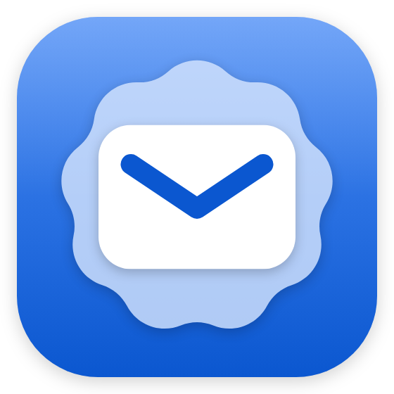
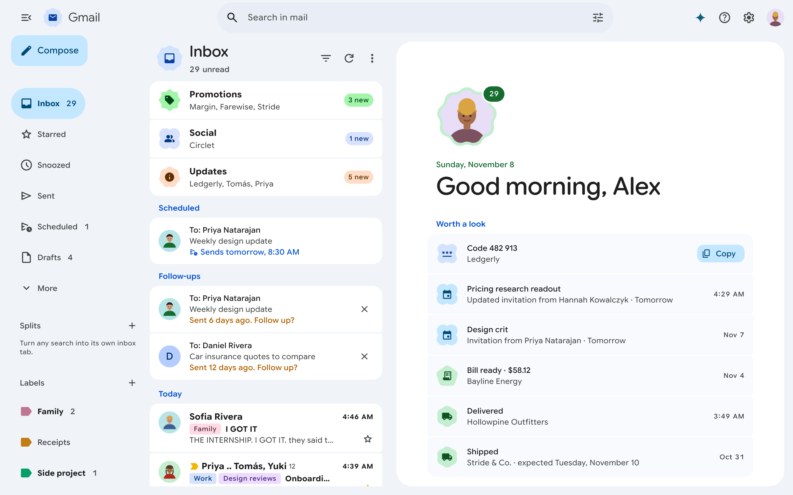
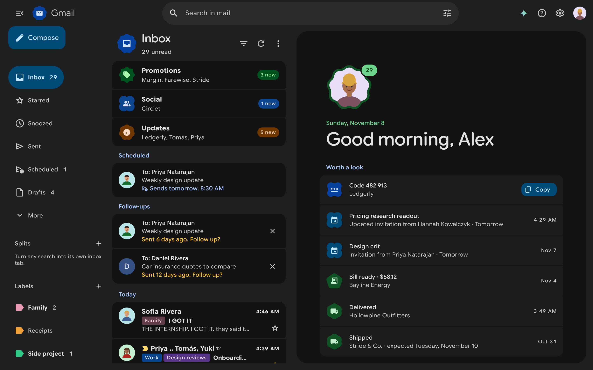
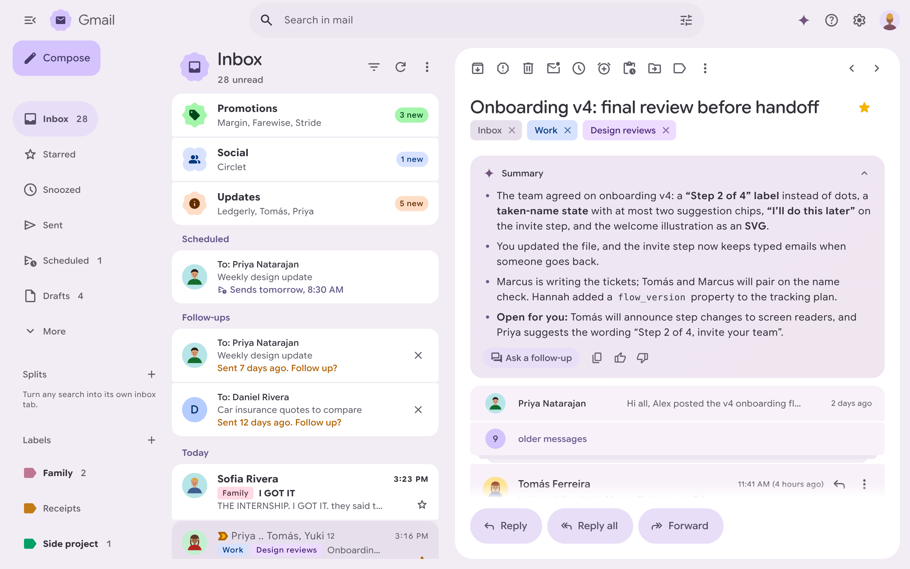
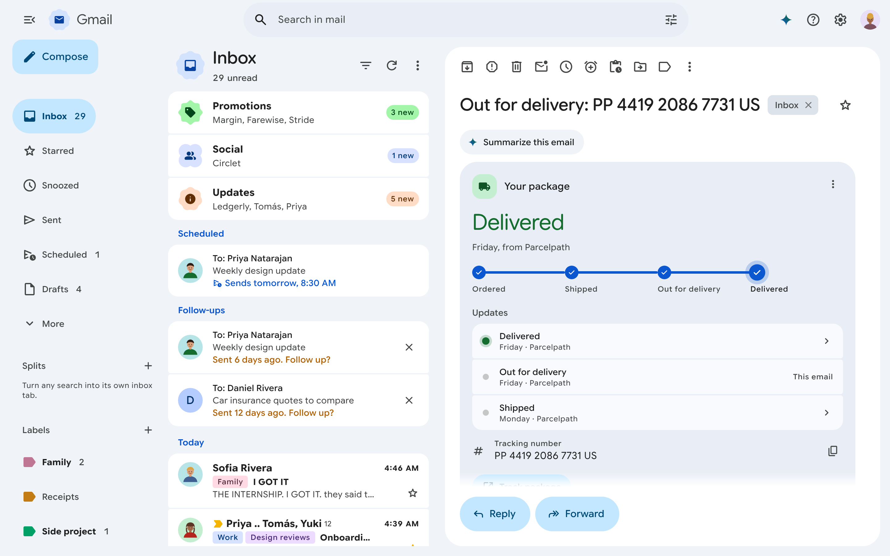
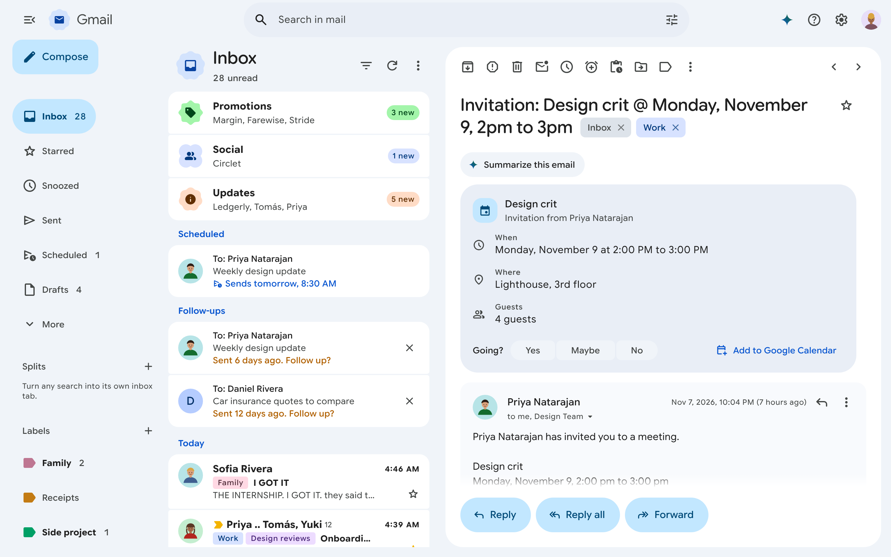
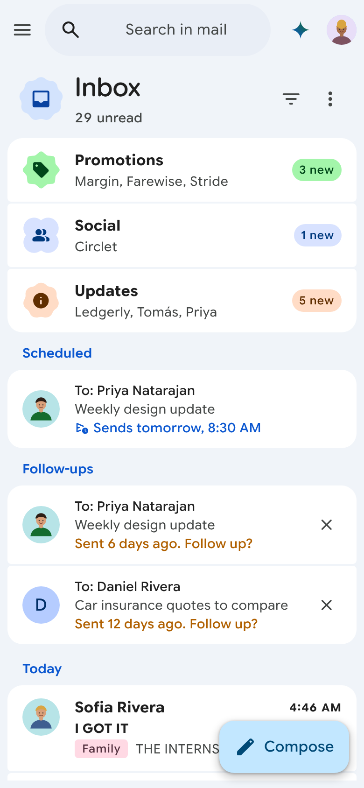

<p align="center">
  
</p>

<h1 align="center">Expressive Gmail</h1>

<p align="center">
  A browser extension that replaces Gmail's interface on mail.google.com<br>
  with a complete Material 3 Expressive redesign. Just go to Gmail and sign in normally!<br>
  Chrome, Firefox and Safari, on desktop and phone.
</p>

<p align="center">
  <a href="https://github.com/slukedev/expressive-gmail/actions/workflows/ci.yml"></a>
  <a href="LICENSE"></a>
</p>



| | |
| --- | --- |
|  |  |
|  |  |

<p align="center"></p>

Expressive Gmail takes over `mail.google.com` with a complete new interface. It keeps your account and session, loses nothing Gmail does, and adds the things Gmail is missing. There is no server: everything runs in your browser and talks only to Google ([PRIVACY.md](PRIVACY.md)).

It is an independent project, not made by, affiliated with or endorsed by Google. Screenshots show the demo mailbox; every person and company in it is made up.

## Install

| Browser | Get it |
| --- | --- |
| Chrome, Dia, Arc, Edge, Brave | [Chrome Web Store](https://chromewebstore.google.com/search/Expressive%20Gmail) |
| Firefox, including Firefox for Android | [Firefox Add-ons](https://addons.mozilla.org/firefox/addon/expressive-gmail/) |
| Safari on Mac | `brew install --cask slukedev/tap/expressive-gmail`, then turn the extension on in Safari > Settings > Extensions |

**From source.** Build every browser into `.output/`:

```bash
npm install
```

```bash
npm run build:all
```

| Browser | Load it |
| --- | --- |
| Chrome, Dia, Arc, Edge, Brave | `chrome://extensions`, turn on Developer mode, **Load unpacked**, choose `.output/chrome-mv3` |
| Firefox | `about:debugging#/runtime/this-firefox`, **Load Temporary Add-on**, pick `.output/firefox-mv3/manifest.json` |
| Safari on Mac | `npm run safari:xcode`, run `safari/Expressive Gmail/Expressive Gmail.xcodeproj` once, enable it in Safari > Settings > Extensions (unsigned builds need Develop > Allow Unsigned Extensions). `TEAM_ID=XXXXXXXXXX npm run safari:install` builds a signed copy into `~/Applications`. |
| Safari on iPhone and iPad | `npm run safari:ios`, pick your team in `safari-ios/Expressive Gmail/Expressive Gmail.xcodeproj`, run it on the device, then turn it on in Settings > Apps > Safari > Extensions. iOS 16.4 or later. |
| Firefox for Android | The Firefox build runs on 128 or later; `npx web-ext run -t firefox-android` over USB debugging ([Mozilla's guide](https://extensionworkshop.com/documentation/develop/developing-extensions-for-firefox-for-android/)). |

The Safari scripts use the bundle ID `com.example.bettergmail` unless you set `BUNDLE_ID`.

On phones Gmail serves its mobile web app, so the extension asks mail.google.com for desktop Gmail (for that site only, and only while the new look is on) and fits it to the screen, the notch and the keyboard.

The toolbar button turns the new look on and off. **Switch to classic Gmail** is in the account menu, Settings, quick settings and the command palette; classic Gmail then shows a small **Switch to Expressive** button to come back.

## Where your mail comes from

Settings > Connection picks the source:

| Source | Setup | Notes |
| --- | --- | --- |
| **Your Gmail session** (default) | None | Gmail's own endpoints with the session you're signed in with. Gmail still loads underneath, hidden. Google can change these endpoints without notice; every write is re-read to confirm it stuck. |
| **Gmail API** | An OAuth client ID ([setup](docs/gmail-api-setup.md)) | Official and stable. Chrome and desktop Firefox only. Snooze and mute are emulated; no schedule send. |
| **Demo mailbox** | Development builds only | A synthetic inbox for the preview and tests. Release builds leave it out. |

## What it adds

- **All your accounts in one place.** Switch in place (`g` then `1` to `9`), read them together in **All inboxes** (`g` `0`), or group a few into a **circle** and read that as one inbox. Replies always go out from the account that received the mail. Mailboxes delegated to you are listed in the account menu and open in their own tab.
- **At a glance.** With nothing open, the reading pane lists what wants a look: fresh verification codes, deliveries on the way, unanswered invitations, bills, questions you haven't replied to, follow-ups that came due.
- **Command palette** (Ctrl/Cmd K) that reaches everything and reads what you type: `snooze fri 9am`, `label work`, `email priya`, `theme dark`, `pause 2h`.
- **Gemini, first party.** Your account's own Gemini, redesigned to fit: summaries, questions about one email or all your mail with sources, Help me write, suggested replies. Only what your plan offers shows.
- **Smart features, rebuilt locally** with plain text matching in your browser: Copy code, package tracking, receipts and bills, flights and stays, calendar invites with real RSVPs, Translate, phishing warnings, desktop notifications.
- **Reply later**, **follow-up reminders**, **pin to top**, **splits** (a saved search as its own inbox tab), **pause inbox**, **private notes**, **templates** with `/shortcut` insert, **next unread** (Shift J / K).
- **Subscriptions** by sender with one-click unsubscribe, an **attachments** gallery, and **Free up space** for big and old mail.
- **Material You themes** from any color or your own photo, Google's palette by default, light, dark and system, three contrast levels, dark emails that match the dark theme, and an **interface size** setting for smaller screens.
- **Tracker blocking**: open-tracking pixels are stripped from every message.
- Date sections, quick filters, a resizable reading pane, swipe actions and pull to refresh on touch, and undo for every action (`z`).

Everything Gmail web does day to day is still there: categories, labels, search operators, threads, compose with formatting and attachments, drafts, undo send, schedule send, snooze, mute, multi-select and Gmail's keyboard shortcuts. Like Gmail's custom keyboard shortcuts, any single-key shortcut can take a different key: press `?` and click a key to change it.

## Develop

```bash
npm run preview
```

Serves the UI at http://localhost:5199 against the demo mailbox (set `PREVIEW_PORT` for another port). `npm run dev` runs the real extension in a fresh Chrome with hot reload.

Query flags for the preview: `?latency=0`, `?empty` (new account), `?onboarding`, `?chaos` (30% of calls fail), `?contacts=fail`, `?accounts=1`, `?delegated=0`, `?accountfail=studio`, `?lag=3000` (writes show up late), `?nodelete`, `?gemini=plan|smart-features|fail`, `?geminiDelay=1500`, `?schedule=off`. `/preview/frame.html` takes the same flags and hosts the preview in a frame the way Gmail's page does, which Interface size needs.

| Script | What it does |
| --- | --- |
| `npm run typecheck`, `npm run lint` | TypeScript and ESLint |
| `npm test` | Vitest unit and backend suites |
| `npm run test:e2e` | Playwright on Chromium, WebKit, Firefox and a phone profile |
| `npm run build:all` | Chrome, Firefox and Safari builds into `.output/` |
| `npm run zip` | Store zips for Chrome and Firefox |
| `npm run safari:xcode`, `safari:ios`, `safari:install` | The Safari wrapper apps |
| `npm run release:mac`, `release:appstore` | Notarized Mac app for Homebrew, App Store upload ([store/README.md](store/README.md)) |
| `npm run store:images` | Store screenshots from the demo mailbox |
| `npm run fonts` | Rebuilds the icon and text font subsets (Python `fonttools` and `brotli`) |

Optional build settings: `WXT_GOOGLE_CLIENT_ID` (a default OAuth client for the Gmail API source), `BUNDLE_ID` and `TEAM_ID` for the Safari and Mac scripts.

[CONTRIBUTING.md](CONTRIBUTING.md) covers the checks to run and the rules; [docs/how-it-works.md](docs/how-it-works.md) explains the backends, sync, accounts and known limits; [DESIGN.md](DESIGN.md) is the visual system.

## License

[GNU General Public License v3.0](LICENSE). Bundled fonts and libraries keep their own licenses ([THIRD_PARTY_NOTICES.md](THIRD_PARTY_NOTICES.md)). Security reports: [SECURITY.md](SECURITY.md). Gmail and Google are trademarks of Google LLC.
